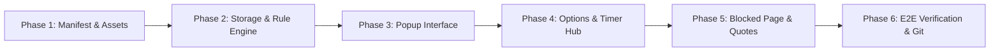

# Product Requirements Document (PRD): StopScroll

**Product Name:** StopScroll  
**Version:** 1.0 (MVP)  
**Target Platform:** Google Chrome (Chromium: Brave, Arc, Edge) on macOS, Windows, Linux  
**Manifest Version:** Manifest V3 (MV3)  
**Status:** Approved for Implementation  
**Repository:** [https://github.com/KaushalDokania/StopScroll](https://github.com/KaushalDokania/StopScroll)  

---

## 1. Executive Summary & Vision

### 1.1 Product Vision
**StopScroll** is a sleek, privacy-focused, zero-bloat website blocker Chrome extension inspired by BlockSite. It empowers knowledge workers, developers, and students to reclaim their focus from addictive feeds, algorithmic loops, and compulsive tab opening.

Unlike commercial alternatives that enforce paid subscriptions, introduce telemetry, or inject heavy background scripts, StopScroll runs **100% locally** using native browser APIs (`declarativeNetRequest`), boasts sub-millisecond execution, and introduces **Timer Groups** for healthy, bounded browsing.

### 1.2 Core Value Proposition
- **Frictionless Control**: Single-toggle blocking shield on a 360px popup.
- **Smart Onboarding**: Instant 1-click blocking with pre-populated frequent sites and authentic brand favicons.
- **Flexible Bounded Browsing**: Instead of all-or-nothing blocking, set pooled daily time allowances across related domains (e.g. 30 mins shared between YouTube, Reddit, and Instagram).
- **Clear Priority Engine**: Deterministic conflict resolution where the Hard Blocklist always supersedes Timer Groups.
- **Motivational Redirection**: Friendly, graphic-rich blocked screen featuring randomized stoic and productivity quotes.

---

## 2. Target Personas & Primary Use Cases

| Persona | Core Pain Point | How StopScroll Solves It |
| :--- | :--- | :--- |
| **Deep-Work Engineer / Writer** | Habitually opening Twitter or Reddit in a new tab during code compilation or thinking pauses. | Instant permanent hard-blocking with redirect to a calming focus screen. |
| **Moderate Scroller** | Wants to watch YouTube tutorials or check news during lunch, but gets sucked in for hours. | Timer Groups that allow 30 minutes daily, then automatically lock out for the remainder of the day. |
| **Privacy-Conscious User** | Distrusts commercial blockers that track browsing history or require cloud accounts. | Fully open-source, local-only `chrome.storage`, zero telemetry. |

---

## 3. Scope of Deliverables

### In-Scope for v1.0 (MVP)
1. **Extension Popup (`popup/`)**:
   - Header with brand shield icon and settings link.
   - Master **Blocking Shield** toggle switch.
   - Active Tab auto-detection with live favicon and 1-click `+ Block` button.
   - Active Timer Group summary bar showing daily minutes remaining.
   - Navigation button to the full Control Hub.
2. **Options & Control Hub (`options/`)**:
   - **Hard Blocklist Tab**:
     - Pre-populated popular/distracting sites grid with icons (YouTube, Reddit, Netflix, Instagram, X/Twitter, TikTok, Twitch, Discord).
     - Real-time search filter and custom domain input.
     - Interactive table: domain, favicon, per-site enable/disable switch, delete button.
   - **Timer Groups Tab**:
     - Create and delete custom Timer Groups.
     - Set daily limits (e.g. 15m, 30m, 45m, 60m).
     - Add/remove domain tags to groups.
     - Visual progress bar showing consumed vs remaining minutes.
   - **Priority Rules Tab**:
     - Educational visual explainer on rule precedence.
3. **Distraction-Free Blocked Screen (`blocked/`)**:
   - Responsive, illustrative layout with glowing backdrop and mascot graphic.
   - Dynamic badge distinguishing *"Permanent Block"* from *"Timer Limit Reached"*.
   - Random productivity quote generator with interactive "New quote" button.
   - Direct buttons: "Go Back to Work" and "Manage Blocklist".
4. **Background Service Worker (`background/`)**:
   - Dynamic rule compiler syncing `storage.local` with `chrome.declarativeNetRequest`.
   - Focus time accumulator using `chrome.idle` and `chrome.tabs`.
   - Daily midnight reset timer via `chrome.alarms`.

### Out-of-Scope for v1.0 (Future Roadmap)
- Password protection / PIN locks to prevent unblocking.
- Pomodoro work/break cyclic timers.
- Cloud account sync across multiple browsers.
- Chrome Web Store public distribution pipeline.

---

## 4. Detailed Functional Requirements (FR)

### FR-1: Extension Popup Menu (`popup/`)
- **FR-1.1 Dimensions**: Fixed width 360px, auto-height (capped at 520px).
- **FR-1.2 Shield Status Card**:
  - Displays a pulsating status dot (Green for active, Amber for paused).
  - Main toggle updates `settings.blockingShield` in `chrome.storage.local`.
- **FR-1.3 Active Tab Quick-Block**:
  - Automatically queries `chrome.tabs.query({ active: true, currentWindow: true })`.
  - Extracts the root hostname (e.g. `https://www.youtube.com/watch?...` $\rightarrow$ `youtube.com`).
  - Fetches the favicon and displays a `+ Block` button that adds the site to the Hard Blocklist with visual feedback (`✓ Blocked`).
- **FR-1.4 Timer Summary Widget**:
  - Displays the active or primary timer group's progress (e.g. `Social Media: 18m left / 30m`).

### FR-2: Options & Control Hub (`options/`)
- **FR-2.1 URL Input & Normalization**:
  - Input field automatically sanitizes inputs: strips `https://`, `http://`, `www.`, queries, and trailing paths (e.g., `https://www.reddit.com/r/all/` $\rightarrow$ `reddit.com`).
- **FR-2.2 Pre-populated Catalog & Search**:
  - Before typing, clicking the search bar displays the catalog of frequent distracting sites with authentic favicons.
  - Typing filters both the catalog and existing list in real-time.
- **FR-2.3 Timer Groups**:
  - Users can create named groups (e.g. "Gaming", "Social Media").
  - Users can define a daily cap in minutes.
  - Multiple domains can be assigned to a group.
- **FR-2.4 Conflict Resolution (Priority Engine)**:
  - **Priority 1 (Hard Block)**: If a site is in `hardBlocklist` and `enabled: true`, it is blocked immediately.
  - **Priority 2 (Timer Groups)**: If not in hard blocklist, check if the site belongs to a timer group. If remaining minutes $> 0$, access is allowed and time accumulates. If remaining minutes $\le 0$, dynamic redirect is activated.
  - **Priority 3 (Default)**: Normal unrestricted browsing.

### FR-3: Distraction-Free Blocked Screen (`blocked/`)
- **FR-3.1 Redirection Parameters**:
  - Receives target URL and reason via URL parameters: `blocked.html?target=reddit.com&reason=hard_block` or `reason=timer_expired&group=Social%20Media`.
- **FR-3.2 Quotes Database**:
  - Bundled array of at least 10 high-impact productivity, mindfulness, and stoic quotes (Seneca, Marcus Aurelius, Cal Newport, James Clear, etc.).
  - Randomly selects one on page load.
  - Includes a "New quote" shuffle button.

---

## 5. Technical Architecture & Data Models

### 5.1 Storage Schema (`chrome.storage.local`)
```typescript
interface StopScrollStorage {
  settings: {
    blockingShield: boolean;      // Master switch for all blocking
    lastResetDate: string;        // "YYYY-MM-DD" for midnight reset check
  };
  hardBlocklist: Array<{
    domain: string;               // e.g. "facebook.com"
    enabled: boolean;             // Individual pause toggle
    addedAt: number;              // Timestamp
    icon?: string;                // Favicon URL
  }>;
  timerGroups: Array<{
    id: string;                   // UUID or slug
    name: string;                 // e.g. "Social Media"
    dailyLimitMinutes: number;    // e.g. 30
    usedMinutes: number;          // Accumulated minutes today
    sites: string[];              // ["youtube.com", "reddit.com", "instagram.com"]
  }>;
}
```

### 5.2 DeclarativeNetRequest Dynamic Rules Generation
When rules sync, `background.js` maps active block conditions to `chrome.declarativeNetRequest.updateDynamicRules`:

```javascript
{
  id: ruleId,
  priority: 1,
  action: {
    type: "redirect",
    redirect: {
      extensionPath: `/blocked/blocked.html?target=${encodeURIComponent(domain)}&reason=${reason}`
    }
  },
  condition: {
    urlFilter: `||${domain}^`,
    resourceTypes: ["main_frame"]
  }
}
```

### 5.3 Active Time Tracking Engine
1. Background service worker listens to `chrome.tabs.onActivated` and `chrome.windows.onFocusChanged`.
2. Inspects active tab URL against `timerGroups`.
3. Checks user idle state via `chrome.idle.queryState(60)`. If user is active (not idle/locked), accumulates active browsing seconds.
4. When `usedMinutes >= dailyLimitMinutes`, triggers `syncDynamicRules()`, instantly redirecting the tab to `blocked.html?reason=timer_expired`.

---

## 6. Non-Functional Requirements (NFR)

- **Performance**:
  - Popup opens in $< 100\text{ ms}$.
  - Network redirects executed natively by Chrome C++ engine with zero visible latency.
- **Resource Footprint**:
  - Background service worker stays dormant and only wakes on tab focus changes, alarms, or storage events.
  - Total unpacked size $< 1.5\text{ MB}$.
- **Privacy & Security**:
  - Zero external tracking, zero analytics scripts, no cookies.
  - All data stays strictly in local browser storage.
  - No `webRequest` blocking permission required (Manifest V3 compliant using `declarativeNetRequest`).
- **Reliability**:
  - Survives browser restarts, macOS sleep, and tab crashes without losing time counts or block rules.

---

## 7. Phased Implementation Plan



- **Phase 1: Project Scaffolding & Manifest Configuration**: `manifest.json`, shield SVG icons (16, 32, 48, 128 px), folder links.
- **Phase 2: Background Service Worker & Engine**: `background.js` implementing rule compilation, `declarativeNetRequest` sync, and `chrome.idle` timer accumulation.
- **Phase 3: Extension Popup UI**: `popup/popup.html`, `popup.css`, `popup.js` with active tab detection, shield switch, and timer readout.
- **Phase 4: Full Options & Timer Hub**: `options/options.html`, `options.css`, `options.js` featuring pre-populated icon search, hard blocklist CRUD, and timer group management.
- **Phase 5: Blocked Screen & Motivational Quotes**: `blocked/blocked.html`, `blocked.css`, `blocked.js` with graphics, stoic quotes generator, and dynamic reason badges.
- **Phase 6: End-to-End Verification & Commit**: Test in Google Chrome via `chrome://extensions`, verify edge cases, and push commits to GitHub `origin/main`.
